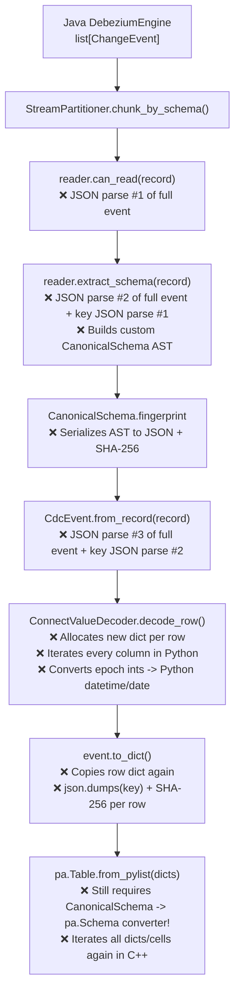
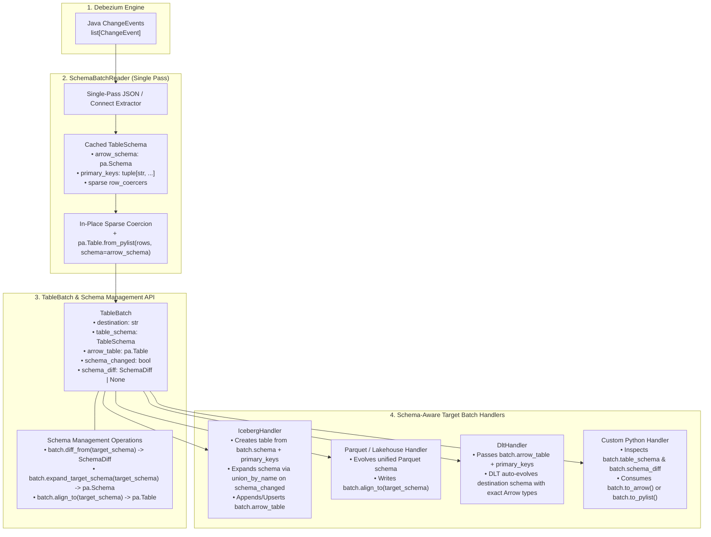

# Review of Current Schema Management & Proposal for a Simple Schema-Oriented Converter Reader and Downstream Schema Manager

## 1. Executive Summary & Main Goal

### Main Goal
The root requirement of `pydbzengine` has two tightly coupled parts:
1. **Schema-Defined Event Reading & Conversion**: Read raw Debezium CDC events using their schema, convert each event's wire values into clean, strongly-typed data structures (specifically **Apache Arrow `pa.Table` / `pa.RecordBatch` and Parquet**, with instant access to typed Python dicts), and hand them over to target batch handlers without an in-between conversion bottleneck.
2. **Effortless Downstream Schema Management & Schema-Aware Consumption**: Empower downstream consumers (Iceberg, Parquet datasets, DLT, DuckDB, or custom handlers) to use the extracted schema directly to:
   - **Create target tables** with exact schema type definitions (`Decimal(precision, scale)`, `Timestamp(unit, tz)`, `Date`, `Time`, `UUID`, `Binary`, `Struct`, `List`, `Map`, `nullable`, column `doc`, and `primary_keys`).
   - **Detect and diff schema changes** (`ADD COLUMN`, `DROP COLUMN`, type widening, nullability changes) when source tables evolve mid-stream.
   - **Expand/evolve target schemas** automatically and **align incoming batches** (padding dropped columns with typed `NULL`s, casting widened types, ordering columns) so downstream sinks consume data in a strictly schema-aware manner.

---

### Verdict on the Current Implementation (`pydbzengine/schema/`)
The current implementation in `pydbzengine/schema/` (6 modules, ~2,420 LOC) contains **valuable domain rules** for Debezium logical type mappings and wire-format decoding (such as Base64 two's-complement `Decimal`, `VariableScaleDecimal`, and temporal conversions).

However, **architecturally it adds too much middleman complexity, creates an in-between conversion bottleneck, and stops short of providing either Arrow/Parquet batches or downstream schema evolution tools**:
1. **Redundant Custom Schema AST (`CanonicalSchema`)**: It invents a custom 18-type Python AST (`CanonicalPrimitiveType`, `CanonicalType`, `CanonicalField`, `CanonicalSchema`) in between Debezium's schema and Apache Arrow (`pyarrow.Schema`). Downstream consumers cannot pass `CanonicalSchema` to Iceberg, Parquet, or DLT—forcing a double translation (`Debezium Schema -> CanonicalSchema -> PyArrow Schema -> Target Sink Schema`).
2. **No Schema Evolution / Target Schema Expansion Tools**: While `CanonicalSchema` computes a SHA-256 fingerprint to detect that *something* changed, it provides **no `SchemaDiff`**, no way to see which columns were added/removed/widened, no target schema expansion (`union_by_name`), and no batch alignment for evolved target tables.
3. **Row-by-Row Object Churn (`CdcEvent` per record)**: Instead of converting batches into columnar Arrow tables (`pa.Table`), it materializes a frozen `CdcEvent` dataclass and multiple Python `dict`s for every single row, running pure-Python `match/case` type dispatch on every cell.
4. **Triple JSON Parsing per Record**: Combining `StreamPartitioner` (`can_read` + `extract_schema`) with `CdcEvent.from_record` parses the same verbose Debezium JSON string (which includes the full `"schema"` block on every event) **up to 3 times per record**.
5. **Unnecessary Python-Level Temporal Conversion**: It converts Debezium integer epoch dates (`io.debezium.time.Date`) and epoch timestamps (`MicroTimestamp`, `Timestamp`) into Python `datetime.date` / `datetime.datetime` objects in pure Python loops, only for PyArrow's C++ engine to convert them *back* into 32/64-bit epoch integers when building `pa.date32()` and `pa.timestamp()` arrays.
6. **Disconnected from Handlers**: Neither [`IcebergChangeHandlerV2`](file:///Users/simseki/IdeaProjects/pydbzengine/pydbzengine/handlers/iceberg.py#L272-L538) nor [`DltChangeHandler`](file:///Users/simseki/IdeaProjects/pydbzengine/pydbzengine/handlers/dlt.py#L45-L78) uses `pydbzengine/schema/`—both still manually parse raw JSON strings inside `handleJsonBatch`.

---

## 2. Detailed Review of the Current Implementation

### 2.1 Current Pipeline vs. What Actually Happens per Batch

Currently, `pydbzengine/schema/` splits event processing across 6 files and 15+ classes:
- [`models.py`](file:///Users/simseki/IdeaProjects/pydbzengine/pydbzengine/schema/models.py): `CanonicalPrimitiveType`, `CanonicalType`, `CanonicalField`, `CanonicalSchema`, `DebeziumConfig`, `EventFormat`, `EventStructure`
- [`base.py`](file:///Users/simseki/IdeaProjects/pydbzengine/pydbzengine/schema/base.py): `BaseSchemaReader`, `BaseValueDecoder`
- [`readers.py`](file:///Users/simseki/IdeaProjects/pydbzengine/pydbzengine/schema/readers.py): `DebeziumSchemaReader`, `InferredSchemaReader`
- [`decoders.py`](file:///Users/simseki/IdeaProjects/pydbzengine/pydbzengine/schema/decoders.py): `ConnectValueDecoder`
- [`events.py`](file:///Users/simseki/IdeaProjects/pydbzengine/pydbzengine/schema/events.py): `CdcEvent`
- [`partitioner.py`](file:///Users/simseki/IdeaProjects/pydbzengine/pydbzengine/schema/partitioner.py): `StreamPartitioner`, `StreamChunk`

When processing a batch of $N$ `ChangeEvent` records through this stack to produce an Arrow table for Iceberg or Parquet, the following bottleneck sequence occurs:



### 2.2 Specific Bottlenecks & Gaps Identified in Code

| Issue | Where in Code | Impact on Performance & Schema Management |
| :--- | :--- | :--- |
| **1. Multi-pass JSON parsing** | [`readers.py#L141`](file:///Users/simseki/IdeaProjects/pydbzengine/pydbzengine/schema/readers.py#L141), [`readers.py#L183`](file:///Users/simseki/IdeaProjects/pydbzengine/pydbzengine/schema/readers.py#L183), [`events.py#L316`](file:///Users/simseki/IdeaProjects/pydbzengine/pydbzengine/schema/events.py#L316) | With `schemas.enable=true`, the JSON string is 5x–10x larger due to the embedded Connect schema. Parsing it 2–3 times per event dominates CPU time. |
| **2. Custom AST instead of `pa.Schema`** | [`models.py#L26-L186`](file:///Users/simseki/IdeaProjects/pydbzengine/pydbzengine/schema/models.py#L26-L186) | Downstream sinks (PyIceberg, PyArrow Parquet, DLT, DuckDB) cannot consume `CanonicalSchema`. Every sink would need a separate adapter to convert `CanonicalSchema` into `pa.Schema`. |
| **3. No Schema Evolution / Diff / Expansion API** | [`models.py#L156-L186`](file:///Users/simseki/IdeaProjects/pydbzengine/pydbzengine/schema/models.py#L156-L186) | Only checks `s1.fingerprint == s2.fingerprint`. Does not identify added columns, dropped columns, or widened types, and cannot align a batch to an expanded target table schema. |
| **4. Full-row dictionary copying & per-cell dispatch** | [`decoders.py#L578-L605`](file:///Users/simseki/IdeaProjects/pydbzengine/pydbzengine/schema/decoders.py#L578-L605) | `decode_row()` allocates a new `result` dict for every event and checks `k in fields_by_name` and `field_type.needs_decoding` for every column—even though `json.loads` *already* produced a fresh mutable `dict` where 70–80% of columns (`int`, `str`, `float`, `bool`) are already native Python types. |
| **5. Python `datetime` allocation for epoch integers** | [`decoders.py#L172-L336`](file:///Users/simseki/IdeaProjects/pydbzengine/pydbzengine/schema/decoders.py#L172-L336) | PyArrow's `pa.date32()`, `pa.time32("ms")`, `pa.time64("us")`, and `pa.timestamp("ms"\|"us"\|"ns")` natively accept integer epoch offsets in C++. Converting `int` $\rightarrow$ `datetime.date` / `datetime.datetime` in Python and back to `int` in Arrow C++ is wasted work. |
| **6. `IcebergChangeHandlerV2` bypasses Debezium schema** | [`handlers/iceberg.py#L365-L380`](file:///Users/simseki/IdeaProjects/pydbzengine/pydbzengine/handlers/iceberg.py#L365-L380) | Uses `pyarrow.json.read_json()` on raw JSON strings, which ignores Debezium's schema, misinterprets epoch dates/timestamps as `int64`, treats Base64 `Decimal`/`Binary` as `string`, and infers `null` columns as `pa.null()`. |

---

## 3. Fresh Proposal: Schema-Oriented Converter Reader + Downstream Schema Manager

### 3.1 Core Architectural Pillars

1. **`TableSchema` (Backed Directly by `pyarrow.Schema`) as the Single Source of Truth**:
   Instead of maintaining a custom `CanonicalSchema` AST, compile Debezium's Connect/JSON schema **directly into a `TableSchema` wrapping `pyarrow.Schema`**:
   - Preserves **exact database types**: `pa.int8()`..`pa.int64()`, `pa.float32()`, `pa.float64()`, `pa.decimal128(precision, scale)`, `pa.date32()`, `pa.time64("us")`, `pa.timestamp("us")`, `pa.timestamp("us", tz="UTC")`, `pa.binary()`, `pa.string()`, `pa.uuid()`, `pa.struct(...)`, `pa.list_(...)`, `pa.map_(...)`.
   - Preserves **field-level metadata**: `nullable=True/False`, `metadata={b"doc": ..., b"debezium.logical_type": ...}` (Note: PyIceberg automatically reads `b"doc"` from `pa.Field.metadata` and `nullable` from `pa.Field.nullable` when creating/evolving Iceberg tables!).
   - Preserves **table-level metadata**: `destination`, `primary_keys: tuple[str, ...]`, and fast structural fingerprinting.

2. **Compile Schema Once, Mutate Only Special Wire Fields In-Place**:
   For a given table, 99.99% of consecutive events share the exact same schema. When a schema is first seen, compile it into `TableSchema` with:
   - `arrow_schema: pa.Schema`
   - `row_coercers: tuple[tuple[str, Callable[[Any], Any]], ...]` — containing **only** the columns that PyArrow C++ cannot coerce directly from `json.loads` output (e.g., Base64 `Decimal` $\rightarrow$ `Decimal`, Base64 `Binary` $\rightarrow$ `bytes`, ISO string $\rightarrow$ `datetime`, or `ms` $\rightarrow$ `us` scaling).
   - Standard columns (`int`, `float`, `bool`, `str`, epoch-day `Date`, epoch-us `MicroTimestamp`) require **zero Python field coercion**!

3. **First-Class Downstream Schema Management (`SchemaDiff`, Target Schema Expansion, & Batch Alignment)**:
   Every `TableBatch` handed to a handler carries its `TableSchema` plus built-in schema management operations so downstream handlers can effortlessly:
   - **Inspect & Diff**: Compare the incoming batch schema against the previous batch schema or an existing target table schema (`batch.diff_from(target_schema) -> SchemaDiff`) to see added fields, removed fields, and widened types.
   - **Expand Target Schema**: Compute an expanded/evolved schema (`TableSchema.expand_target_schema(existing_target_schema, incoming_schema)`) that adds new columns, widens promoted types (`int32 -> int64`, `float32 -> float64`, `decimal(p1, s) -> decimal(p2, s)`), and retains omitted historical columns as `nullable=True`.
   - **Align Data to Target Schema**: Call `batch.align_to(target_schema) -> pa.Table` to automatically pad missing/dropped target columns with typed `NULL`s, cast widened columns in C++, and reorder columns to match the target table.

---

### 3.2 End-to-End Architecture Diagram



---

### 3.3 Direct Debezium $\rightarrow$ Arrow Type Mapping Table

PyArrow's C++ `pa.Table.from_pylist(rows, schema=pa_schema)` natively understands Debezium's wire primitives when given an explicit `pa.Schema`:

| Debezium Type / Logical Name | Wire Value after `json.loads` | Target `pa.DataType` | Python Coercer Needed? | `.to_pylist()` Output |
| :--- | :--- | :--- | :--- | :--- |
| `boolean` | `bool` | `pa.bool_()` | **None** (C++ native) | `bool` |
| `int8` / `int16` / `int32` / `int64` | `int` | `pa.int8()`..`pa.int64()` | **None** (C++ native) | `int` |
| `float32` / `float64` | `float` | `pa.float32()` / `pa.float64()` | **None** (C++ native) | `float` |
| `string` / `Json` / `Enum` / `Uuid` | `str` | `pa.string()` | **None** (C++ native) | `str` |
| `io.debezium.time.Date` | `int` (epoch days) | `pa.date32()` | **None** if `int`! (C++ native) | `datetime.date` |
| `io.debezium.time.MicroTime` | `int` (us of day) | `pa.time64("us")` | **None** if `int`! (C++ native) | `datetime.time` |
| `io.debezium.time.Time` | `int` (ms of day) | `pa.time64("us")` | `ms * 1000` (if `int`) | `datetime.time` |
| `io.debezium.time.MicroTimestamp` | `int` (epoch us) | `pa.timestamp("us")` | **None** if `int`! (C++ native) | `datetime.datetime` |
| `io.debezium.time.Timestamp` | `int` (epoch ms) | `pa.timestamp("us")` | `ms * 1000` (if `int`) | `datetime.datetime` |
| `io.debezium.time.ZonedTimestamp` | `str` (ISO-8601) | `pa.timestamp("us", tz="UTC")` | ISO string $\rightarrow$ `datetime` | `datetime.datetime` (UTC) |
| `connect.data.Decimal` | `str` (Base64) or numeric | `pa.decimal128(p, s)` | Base64/str $\rightarrow$ `Decimal` | `decimal.Decimal` |
| `VariableScaleDecimal` | `{"scale": s, "value": b64}` | `pa.decimal128(38, s)` | Struct $\rightarrow$ `Decimal` | `decimal.Decimal` |
| `bytes` / `Bits` | `str` (Base64) | `pa.binary()` | `base64.b64decode` | `bytes` |
| `struct` / `array` / `map` | `dict` / `list` / `dict` | `pa.struct` / `list_` / `map_` | **None** (unless child needs coercion) | `dict` / `list` |

---

### 3.4 Concrete Design of the Schema Management & Converter Components

The entire design consists of three clean, focused abstractions (~400 LOC total):

#### 1. `SchemaDiff` & `TableSchema` (Schema Definition + Downstream Evolution API)

```python
from dataclasses import dataclass
from typing import Any, Callable
import pyarrow as pa
import pyarrow.compute as pc
import pyarrow.parquet as pq


@dataclass(frozen=True)
class SchemaDiff:
    """
    Structured schema comparison result between an existing target schema
    and an incoming CDC batch schema.
    """

    added_fields: tuple[pa.Field, ...] = ()
    removed_fields: tuple[pa.Field, ...] = ()
    type_changes: tuple[tuple[pa.Field, pa.Field], ...] = ()  # (old_field, new_field)
    nullability_changes: tuple[tuple[pa.Field, pa.Field], ...] = ()

    @property
    def has_changes(self) -> bool:
        return bool(
            self.added_fields
            or self.removed_fields
            or self.type_changes
            or self.nullability_changes
        )

    @property
    def has_expansion(self) -> bool:
        """True if the target table schema needs to be expanded (new columns or widened types)."""
        return bool(self.added_fields or self.type_changes or self.nullability_changes)


@dataclass(frozen=True)
class TableSchema:
    """
    Compiled, schema-aware descriptor for a CDC destination table.
    Combines a standard PyArrow Schema with primary keys, sparse value coercers,
    and downstream schema evolution helpers.
    """

    destination: str
    arrow_schema: pa.Schema
    primary_keys: tuple[str, ...]
    row_coercers: tuple[tuple[str, Callable[[Any], Any]], ...]
    fingerprint: str

    @property
    def column_names(self) -> list[str]:
        return self.arrow_schema.names

    def field(self, name: str) -> pa.Field | None:
        idx = self.arrow_schema.get_field_index(name)
        return self.arrow_schema.field(idx) if idx != -1 else None

    def coerce_row_in_place(self, row: dict[str, Any]) -> dict[str, Any]:
        """Mutates only the fields in `row` that require wire-format decoding."""
        for col_name, coerce_fn in self.row_coercers:
            val = row.get(col_name)
            if val is not None:
                row[col_name] = coerce_fn(val)
        return row

    def diff_from(self, target_schema: pa.Schema | TableSchema) -> SchemaDiff:
        """
        Computes the exact structural difference from `target_schema` (old/target)
        to `self.arrow_schema` (new/incoming).
        """
        old_pa = (
            target_schema.arrow_schema
            if isinstance(target_schema, TableSchema)
            else target_schema
        )
        new_pa = self.arrow_schema

        old_map = {f.name: f for f in old_pa}
        new_map = {f.name: f for f in new_pa}

        added = tuple(f for name, f in new_map.items() if name not in old_map)
        removed = tuple(f for name, f in old_map.items() if name not in new_map)
        type_changes = []
        null_changes = []

        for name, new_f in new_map.items():
            if name in old_map:
                old_f = old_map[name]
                if not old_f.type.equals(new_f.type):
                    type_changes.append((old_f, new_f))
                if old_f.nullable != new_f.nullable:
                    null_changes.append((old_f, new_f))

        return SchemaDiff(
            added_fields=added,
            removed_fields=removed,
            type_changes=tuple(type_changes),
            nullability_changes=tuple(null_changes),
        )

    def expand_target_schema(self, target_schema: pa.Schema | TableSchema) -> pa.Schema:
        """
        Non-destructively expands `target_schema` with new fields and widened types
        from `self.arrow_schema` (union-by-name semantics for Lakehouse / Parquet / Iceberg):
        - Existing fields in target_schema keep their position.
        - Fields removed in source become nullable in the expanded target schema.
        - Widened types (e.g. int32 -> int64, float32 -> float64) are promoted.
        - New fields in self.arrow_schema are appended as nullable.
        """
        old_pa = (
            target_schema.arrow_schema
            if isinstance(target_schema, TableSchema)
            else target_schema
        )
        new_map = {f.name: f for f in self.arrow_schema}
        expanded_fields: list[pa.Field] = []

        for old_f in old_pa:
            if old_f.name not in new_map:
                # Dropped in source: retain in target schema as nullable
                expanded_fields.append(old_f.with_nullable(True))
            else:
                new_f = new_map[old_f.name]
                promoted_type = self._promote_type(old_f.type, new_f.type)
                expanded_fields.append(
                    old_f.with_type(promoted_type).with_nullable(
                        old_f.nullable or new_f.nullable
                    )
                )

        existing_names = {f.name for f in old_pa}
        for new_f in self.arrow_schema:
            if new_f.name not in existing_names:
                expanded_fields.append(new_f.with_nullable(True))

        return pa.schema(expanded_fields, metadata=self.arrow_schema.metadata)

    @staticmethod
    def _promote_type(old_t: pa.DataType, new_t: pa.DataType) -> pa.DataType:
        if old_t.equals(new_t):
            return old_t
        if pa.types.is_signed_integer(old_t) and pa.types.is_signed_integer(new_t):
            return new_t if new_t.bit_width > old_t.bit_width else old_t
        if pa.types.is_floating(old_t) and pa.types.is_floating(new_t):
            return new_t if new_t.bit_width > old_t.bit_width else old_t
        return new_t
```

#### 2. `TableBatch` (Converted Data + Schema Alignment Handover)

```python
@dataclass(frozen=True)
class TableBatch:
    """
    Strongly-typed batch of CDC events for a single destination and schema version.
    Carries both the converted Arrow Table and full schema management context.
    """

    destination: str
    table_schema: TableSchema
    arrow_table: pa.Table
    schema_changed: bool = False
    schema_diff: SchemaDiff | None = None

    @property
    def schema(self) -> pa.Schema:
        """The PyArrow Schema with exact column types, nullability, and field docs."""
        return self.table_schema.arrow_schema

    @property
    def primary_keys(self) -> tuple[str, ...]:
        return self.table_schema.primary_keys

    @property
    def num_rows(self) -> int:
        return self.arrow_table.num_rows

    @property
    def table_name(self) -> str:
        return self.destination.rsplit(".", 1)[-1]

    def diff_from(self, target_schema: pa.Schema | TableSchema) -> SchemaDiff:
        """Compares this batch's schema against a downstream target table's schema."""
        return self.table_schema.diff_from(target_schema)

    def expand_target_schema(self, target_schema: pa.Schema | TableSchema) -> pa.Schema:
        """Returns an expanded target `pa.Schema` incorporating any new/widened columns from this batch."""
        return self.table_schema.expand_target_schema(target_schema)

    def align_to(self, target_schema: pa.Schema | TableSchema) -> pa.Table:
        """
        Aligns this batch's Arrow Table to match `target_schema` in C++:
        - Adds missing target columns as typed NULL arrays (e.g., dropped source columns).
        - Casts columns whose types were widened in `target_schema`.
        - Reorders columns to match `target_schema`.
        """
        target_pa = (
            target_schema.arrow_schema
            if isinstance(target_schema, TableSchema)
            else target_schema
        )
        if self.arrow_table.schema.equals(target_pa):
            return self.arrow_table

        columns: list[pa.Array | pa.ChunkedArray] = []
        src_names = set(self.arrow_table.schema.names)

        for field in target_pa:
            if field.name in src_names:
                col = self.arrow_table.column(field.name)
                if not col.type.equals(field.type):
                    col = pc.cast(col, field.type)
                columns.append(col)
            else:
                columns.append(pa.nulls(self.num_rows, type=field.type))

        return pa.Table.from_arrays(columns, schema=target_pa)

    def to_arrow(self) -> pa.Table:
        return self.arrow_table

    def to_parquet(
        self, where: Any, target_schema: pa.Schema | None = None, **kwargs: Any
    ) -> None:
        """Writes this batch (optionally aligned to `target_schema`) directly to Parquet."""
        tbl = (
            self.align_to(target_schema)
            if target_schema is not None
            else self.arrow_table
        )
        pq.write_table(tbl, where, **kwargs)

    def to_pylist(self) -> list[dict[str, Any]]:
        """Returns rows as Python dicts with native Python types (datetime, date, Decimal, bytes)."""
        return self.arrow_table.to_pylist()
```

#### 3. `SchemaBatchReader` & `BaseBatchChangeHandler` (Single-Pass Reader & Handover)

```python
class SchemaBatchReader:
    """
    Single-pass, schema-oriented reader that converts raw Debezium ChangeEvents
    into strongly-typed TableBatches with automatic schema evolution tracking.
    """

    def read_batch(self, records: list[ChangeEvent]) -> list[TableBatch]:
        ...
        # 1. Single JSON parse per record (or direct Connect Struct access).
        # 2. Resolves/caches TableSchema per destination.
        # 3. Detects if TableSchema changed from the previous schema for that destination,
        #    automatically computing `schema_diff: SchemaDiff` and flushing any prior chunk
        #    so V1 rows and V2 rows are yielded in strict arrival order.
        # 4. Applies sparse `table_schema.coerce_row_in_place(row)` ONLY on fields needing wire decoding.
        # 5. Builds `pa.Table.from_pylist(rows, schema=table_schema.arrow_schema)` and returns `TableBatch`.
```

---

### 3.5 How Downstream Consumers Use Schema & Data Effortlessly

#### Use Case 1: Apache Iceberg (`IcebergChangeHandlerV2`) — Full Schema Creation & Evolution
```python
class IcebergChangeHandlerV2(BaseBatchChangeHandler):
    def handle_table_batch(self, batch: TableBatch) -> None:
        try:
            table = self.get_table(batch.destination)
        except NoSuchTableError:
            # 1. Create table directly from batch.schema (exact Decimal, Date, Timestamp, nullable, docs!)
            table = self.catalog.create_table(
                identifier=self.destination_to_table_identifier(batch.destination),
                schema=batch.schema,
            )
            self.tables[batch.destination] = table

        # 2. Expand target Iceberg schema if incoming batch has new or widened columns
        diff = batch.diff_from(table.schema().as_arrow())
        if diff.has_expansion:
            with table.update_schema() as update:
                update.union_by_name(batch.schema)
            self.log.info(
                f"Expanded schema for {batch.destination}: "
                f"added={[f.name for f in diff.added_fields]}, "
                f"widened={[(o.name, str(n.type)) for o, n in diff.type_changes]}"
            )

        # 3. Align batch to target Iceberg table schema (pads any dropped source columns with NULLs) & append
        aligned_arrow = batch.align_to(table.schema().as_arrow())
        table.append(aligned_arrow)
```

#### Use Case 2: Parquet Lakehouse / Partitioned File Writer with Schema Expansion
```python
class ParquetChangeHandler(BaseBatchChangeHandler):
    def __init__(self, base_dir: Path) -> None:
        super().__init__()
        self.base_dir = base_dir
        self.target_schemas: dict[str, pa.Schema] = {}

    def handle_table_batch(self, batch: TableBatch) -> None:
        dest = batch.destination
        if dest not in self.target_schemas:
            self.target_schemas[dest] = batch.schema
        elif batch.schema_changed:
            # Expand target schema non-destructively (new columns added, dropped columns kept nullable)
            self.target_schemas[dest] = batch.expand_target_schema(
                self.target_schemas[dest]
            )

        # Write Parquet guaranteed to match the expanded target schema
        out_file = self.base_dir / batch.table_name / f"part-{uuid4()}.parquet"
        batch.to_parquet(out_file, target_schema=self.target_schemas[dest])
```

#### Use Case 3: DLT (`DltChangeHandler`) — Zero-Inference Schema-Aware Loading
```python
class DltChangeHandler(BaseBatchChangeHandler):
    def handle_batches(self, batches: list[TableBatch]) -> None:
        resources = [
            dlt.resource(
                batch.arrow_table,
                name=batch.table_name,
                primary_key=list(batch.primary_keys) or None,
            )
            for batch in batches
        ]
        self.dlt_pipeline.run(resources)
```
Because `batch.arrow_table` is a strongly-typed `pa.Table`, `dlt` reads the exact column types from `batch.schema`, automatically evolves the destination warehouse table when new columns appear in `batch.arrow_table`, and enforces `batch.primary_keys`.

#### Use Case 4: Custom Downstream Database / Warehouse Sink Using `SchemaDiff`
```python
class CustomWarehouseHandler(BaseBatchChangeHandler):
    def handle_table_batch(self, batch: TableBatch) -> None:
        if batch.schema_changed and batch.schema_diff:
            for added_field in batch.schema_diff.added_fields:
                # Downstream consumer has exact pa.Field (name, type, nullable, doc) to emit DDL
                self.execute_ddl(
                    f"ALTER TABLE {batch.table_name} ADD COLUMN {added_field.name} ..."
                )

        # Consume as Arrow or as clean Python dicts (with Decimal, datetime, date, bytes)
        for row in batch.to_pylist():
            self.write_row(row)
```

---

## 4. Side-by-Side Comparison: Current vs. Proposed

| Dimension | Current (`pydbzengine/schema/` PR #60) | Proposed (`SchemaBatchReader` + `TableSchema` + `TableBatch`) |
| :--- | :--- | :--- |
| **Schema Representation** | Custom `CanonicalSchema` AST (`CanonicalType`, `CanonicalField`, `CanonicalPrimitiveType`) | **`TableSchema`** backed directly by **`pyarrow.Schema`** (`pa.Field`, `pa.DataType`, `primary_keys`) |
| **Downstream Schema Evolution** | None (only boolean SHA-256 fingerprint equality check) | **`SchemaDiff`** (`added_fields`, `removed_fields`, `type_changes`), **`expand_target_schema()`**, and **`batch.align_to(target_schema)`** |
| **Batch Representation** | Raw `ChangeEvent` list (`StreamChunk`) or per-row `CdcEvent` | **`TableBatch`** (wrapping `pa.Table`, `TableSchema`, `schema_changed`, `schema_diff`) |
| **JSON Parses per Event** | Up to **3x** (`can_read` + `extract_schema` + `CdcEvent.from_record`) | **1x** (Single pass in `SchemaBatchReader.read_batch`) |
| **Row Decoding Strategy** | Allocates new dict per row; runs `match/case` on every column of every row | Compiles **sparse `row_coercers`** once per schema; mutates only special wire columns (`Decimal`, `Binary`, etc.) in-place |
| **Epoch Date/Timestamp Handling** | Converts `int` $\rightarrow$ Python `datetime` $\rightarrow$ Arrow C++ `int` | Passed directly as `int` to Arrow C++ (`pa.date32()`, `pa.timestamp("us")`); `.to_pylist()` materializes `datetime` in C++ |
| **Handler Integration** | Disconnected; handlers still parse raw JSON manually | Built-in via `BaseBatchChangeHandler.handle_table_batch(batch: TableBatch)` |
| **Code Footprint** | ~2,420 LOC across 6 files (15+ classes) | ~400 LOC across 2–3 focused modules |

---

## 5. Recommended Action Plan

1. **Replace `CanonicalSchema` AST with `TableSchema` (Backed by `pyarrow.Schema`)**:
   - Map Debezium's Connect/JSON schema directly into `pa.Field` (preserving exact `pa.decimal128`, `pa.timestamp`, `pa.date32`, `pa.time64`, `pa.binary`, `pa.struct`, `pa.list_`, `pa.map_`, `nullable`, and field `doc` metadata) and attach `primary_keys` + sparse `row_coercers`.
2. **Add First-Class Schema Evolution & Alignment Methods (`SchemaDiff`, `expand_target_schema`, `align_to`)**:
   - Enable downstream handlers to diff incoming schemas against existing target schemas, expand target schemas non-destructively, and align `pa.Table` batches in C++ (`pc.cast` + `pa.nulls` padding).
3. **Implement Single-Pass `SchemaBatchReader` & `BaseBatchChangeHandler`**:
   - Parse each event once, slice batches in order when a mid-batch schema change occurs, attach `schema_diff` to the transitioned `TableBatch`, and hand over `TableBatch` directly to [`IcebergChangeHandlerV2`](file:///Users/simseki/IdeaProjects/pydbzengine/pydbzengine/handlers/iceberg.py#L272-L538), [`DltChangeHandler`](file:///Users/simseki/IdeaProjects/pydbzengine/pydbzengine/handlers/dlt.py#L45-L78), and custom handlers.
