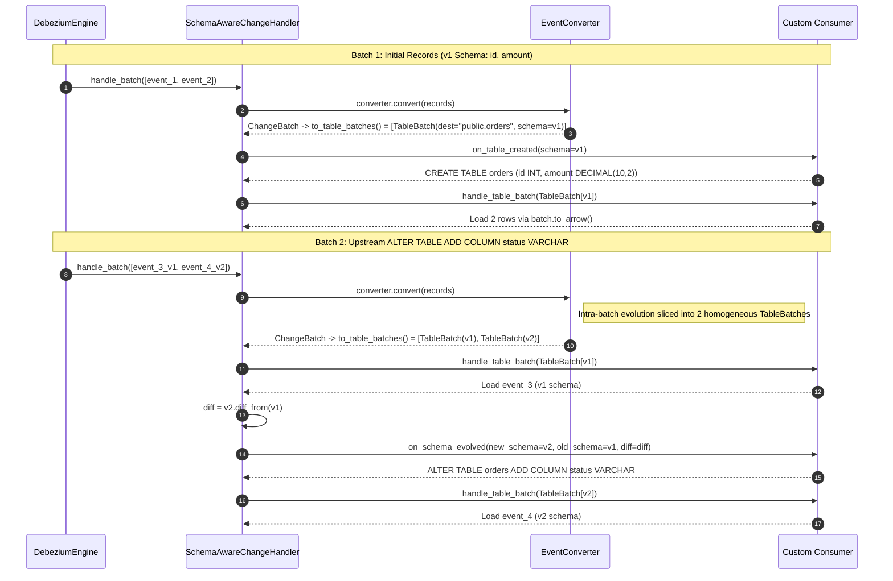

# Schema-Aware Consumer & Examples

`SchemaAwareChangeHandler` (`pydbzengine.schema.consumer`, re-exported from `pydbzengine.schema`) is the base class for schema-driven CDC consumers. It converts incoming `ChangeEvent` batches via `EventConverter`, tracks the active `TableSchema` per destination, and dispatches homogeneous `TableBatch` runs while letting consumers split `ChangeBatch` by `EventKind` or destination in `handle_change_batch()`.

## Lifecycle Hooks & Dispatch Sequence

When `DebeziumEngine` passes a batch of `ChangeEvent` records to `SchemaAwareChangeHandler.handle_batch()`, the handler converts the batch into a `ChangeBatch` and passes it to `handle_change_batch(batch)`. The default implementation iterates `batch.to_table_batches()` (grouping `EventKind.DATA` records per destination and splitting only when `TableSchema` changes—never fragmenting on tombstones) and invokes:

1. **`reconcile_schema(self, schema: TableSchema) -> SchemaDiff | None`**
   Atomically updates tracked schema state for `schema.destination`, calling `on_table_created` or `on_schema_evolved` before recording the new schema. Also available to custom `handle_change_batch()` overrides.
2. **`on_table_created(self, schema: TableSchema) -> None`**
   Called the first time a `TableSchema` is observed for a destination.
3. **`on_schema_evolved(self, new_schema: TableSchema, old_schema: TableSchema, diff: SchemaDiff) -> None`**
   Called whenever a destination's `TableSchema` differs from its previously tracked version (`diff.has_changes`), passing the computed `SchemaDiff`.
4. **`handle_table_batch(self, batch: TableBatch) -> None`**
   Called for each homogeneous `TableBatch` after `on_table_created` or `on_schema_evolved` has completed.

To handle non-data event groups (`TOMBSTONE`, `SCHEMA_CHANGE`, `HEARTBEAT`) or custom cross-table / causal ordering, override `handle_change_batch(self, batch: ChangeBatch)` and slice `batch` with `batch.of_kind(...)`, `batch.group_by_kind()`, and `batch.group_by_destination()`.

You can inspect tracked schemas via `self.schemas` (returns a copy of `dict[str, TableSchema]`) or `self.get_schema(destination)`.

When attached to `DebeziumEngine`, the engine calls `handler.configure(config)` automatically. For standalone use or testing, pass `config=DebeziumConfig(...)` or `converter=...` to `SchemaAwareChangeHandler(...)`, or call `handler.configure(config)` directly. Pass `default_variable_scale` (default `10`) to customize the Arrow decimal scale for `VariableScaleDecimal` fields.



---

## PyArrow Consumer Example (Default Debezium Envelope)

Without an unwrapping SMT, Debezium emits standard CDC envelopes (`before`, `after`, `source`, `op`, `ts_ms`). `TableSchema.arrow_schema` compiles the envelope directly, and `SchemaDiff.is_additive` detects nullable column additions inside the nested `before`/`after` structs:

```python
from pydbzengine import DebeziumEngine
from pydbzengine.schema import (
    SchemaAwareChangeHandler,
    SchemaDiff,
    TableBatch,
    TableSchema,
)


class ArrowBatchHandler(SchemaAwareChangeHandler):
    def on_table_created(self, schema: TableSchema) -> None:
        self.logger.info(
            "Table created: %s (key_fields=%s, columns=%s)",
            schema.destination,
            schema.key_fields,
            schema.arrow_schema.names,
        )

    def on_schema_evolved(
        self,
        new_schema: TableSchema,
        old_schema: TableSchema,
        diff: SchemaDiff,
    ) -> None:
        self.logger.info(
            "Schema evolved for %s: additive=%s, compatible=%s, added=%s, changed=%s",
            new_schema.destination,
            diff.is_additive,
            diff.is_compatible,
            [f.name for f in diff.added_fields],
            [old_f.name for old_f, _ in diff.changed_fields],
        )

    def handle_table_batch(self, batch: TableBatch) -> None:
        arrow_table = batch.to_arrow()
        self.logger.info(
            "Consumed %d records for %s (columns=%s)",
            arrow_table.num_rows,
            batch.destination,
            arrow_table.column_names,
        )


if __name__ == "__main__":
    props = {
        "name": "arrow-cdc-consumer",
        "connector.class": "io.debezium.connector.postgresql.PostgresConnector",
        "database.hostname": "localhost",
        "database.port": "5432",
        "database.user": "postgres",
        "database.password": "postgres",
        "database.dbname": "inventory",
        "topic.prefix": "cdc",
        "offset.storage": "org.apache.kafka.connect.storage.FileOffsetBackingStore",
        "offset.storage.file.filename": "/tmp/offsets.dat",
    }

    handler = ArrowBatchHandler()
    engine = DebeziumEngine(properties=props, handler=handler)
    engine.run()
```

---

## DuckDB / Arrow Sink Example (`ExtractNewRecordState`)

When loading into an analytical or relational table, configure Debezium's `ExtractNewRecordState` SMT (`io.debezium.transforms.ExtractNewRecordState`) with `add.fields = op` and `delete.tombstone.handling.mode = rewrite`. Debezium then emits flat table rows so `TableBatch` can be queried directly via DuckDB's Arrow PyCapsule support:

```python
import duckdb
import pyarrow as pa

from pydbzengine import DebeziumEngine
from pydbzengine.schema import (
    SchemaAwareChangeHandler,
    SchemaDiff,
    TableBatch,
    TableSchema,
)


class DuckDBChangeHandler(SchemaAwareChangeHandler):
    def __init__(self, conn: duckdb.DuckDBPyConnection) -> None:
        super().__init__()
        self.conn = conn

    def on_table_created(self, schema: TableSchema) -> None:
        empty = schema.arrow_schema.empty_table()
        self.conn.execute(
            f'CREATE TABLE IF NOT EXISTS "{schema.table_name}" AS SELECT * FROM empty'
        )

    def on_schema_evolved(
        self,
        new_schema: TableSchema,
        old_schema: TableSchema,
        diff: SchemaDiff,
    ) -> None:
        if not diff.is_compatible:
            raise RuntimeError(
                f"Incompatible schema change on {new_schema.destination}: "
                f"removed={[f.name for f in diff.removed_fields]}"
            )
        for field in diff.added_fields:
            col_empty = pa.schema([field]).empty_table()
            col_type = self.conn.execute(
                "SELECT column_type FROM (DESCRIBE SELECT * FROM col_empty)"
            ).fetchone()[0]
            self.conn.execute(
                f'ALTER TABLE "{new_schema.table_name}" ADD COLUMN "{field.name}" {col_type}'
            )

    def handle_table_batch(self, batch: TableBatch) -> None:
        # TableBatch implements __arrow_c_stream__, so DuckDB reads it directly.
        self.conn.execute(
            f'INSERT INTO "{batch.schema.table_name}" BY NAME SELECT * FROM batch'
        )


if __name__ == "__main__":
    conn = duckdb.connect("cdc.duckdb")
    dbz_props = {
        "name": "duckdb-cdc-engine",
        "connector.class": "io.debezium.connector.postgresql.PostgresConnector",
        "database.hostname": "localhost",
        "database.port": "5432",
        "database.user": "postgres",
        "database.password": "postgres",
        "database.dbname": "inventory",
        "topic.prefix": "cdc",
        "table.include.list": "public.customers,public.orders",
        "offset.storage": "org.apache.kafka.connect.storage.FileOffsetBackingStore",
        "offset.storage.file.filename": "/tmp/duckdb_offsets.dat",
        "transforms": "unwrap",
        "transforms.unwrap.type": "io.debezium.transforms.ExtractNewRecordState",
        "transforms.unwrap.add.fields": "op",
        "transforms.unwrap.delete.tombstone.handling.mode": "rewrite",
    }

    engine = DebeziumEngine(
        properties=dbz_props,
        handler=DuckDBChangeHandler(conn=conn),
        format="connect",
    )
    engine.run()
```

---

## Lifecycle Events, Schema Alignment & Standalone Conversion

### Handling Tombstones, DDL Events, and Heartbeats in Batch
Override `handle_change_batch(self, batch: ChangeBatch)` to split the batch via `batch.group_by_kind()`, `batch.of_kind(...)`, and `batch.group_by_destination()` and process each group in batch fashion (while reusing `super().handle_change_batch(batch)` or `self.reconcile_schema(...)` for schema tracking):

```python
from pydbzengine.schema import (
    ChangeBatch,
    EventKind,
    SchemaAwareChangeHandler,
    TableBatch,
)


class LifecycleAwareHandler(SchemaAwareChangeHandler):
    def handle_change_batch(self, batch: ChangeBatch) -> None:
        groups = batch.group_by_kind()

        if ddls := groups.get(EventKind.SCHEMA_CHANGE):
            self.logger.info("Received %d DDL event(s)", len(ddls))

        if data := groups.get(EventKind.DATA):
            for table_batch in data.to_table_batches():
                self.reconcile_schema(table_batch.schema)
                self.handle_table_batch(table_batch)

        if tombstones := groups.get(EventKind.TOMBSTONE):
            for dest, dest_ts in tombstones.group_by_destination().items():
                keys = [r.key for r in dest_ts]
                self.logger.info("Batch delete %d key(s) on %s", len(keys), dest)

        if heartbeats := groups.get(EventKind.HEARTBEAT):
            self.logger.debug("Latest heartbeat: %s", heartbeats.records[-1].value)

    def handle_table_batch(self, batch: TableBatch) -> None:
        table = batch.to_arrow()
        self.logger.info("Batch for %s: %d rows", batch.destination, table.num_rows)
```

For key-value sinks that require strict causal replay across interleaved `DATA` and `TOMBSTONE` events (for example, `ExtractNewRecordState` with `delete.tombstone.handling.mode=tombstone`), pass multiple kinds to `of_kind()` to preserve exact arrival order:

```python
class CausalKvHandler(SchemaAwareChangeHandler):
    def handle_change_batch(self, batch: ChangeBatch) -> None:
        mutations = batch.of_kind(EventKind.DATA, EventKind.TOMBSTONE)
        for dest, dest_batch in mutations.group_by_destination().items():
            for record in dest_batch:
                if record.kind is EventKind.DATA:
                    if record.schema is not None:
                        self.reconcile_schema(record.schema)
                    self.logger.info("Upsert %s key=%s", dest, record.key)
                else:
                    self.logger.info("Delete %s key=%s", dest, record.key)
```

### Aligning Batches to an Evolved `target_schema`
When writing heterogeneous historical batches into a single target table schema (including nested `before`/`after` envelope structs on `pyarrow>=19.0.0`), pass `target_schema` to `TableBatch.to_arrow()`:

```python
aligned_table = table_batch.to_arrow(target_schema=latest_table_schema.arrow_schema)
```

`to_arrow(target_schema=...)` projects and reorders top-level columns, casts widened types (including temporal units and nested struct subfield additions, drops, and widenings while preserving surviving subfield order on `pyarrow>=19.0.0`, or full subfield reordering on `pyarrow>=21.0.0`), fills missing nullable columns with nulls, and enforces target nullability constraints recursively.

### Standalone `EventConverter` Usage
`EventConverter` can also be used directly without subclassing `SchemaAwareChangeHandler`:

```python
from pydbzengine import DebeziumConfig
from pydbzengine.schema import EventConverter, JsonEventConverter

# Direct instantiation for schema-enabled JSON records
converter = JsonEventConverter()
change_batch = converter.convert(raw_events)

for table_batch in change_batch.to_table_batches():
    arrow_table = table_batch.to_arrow()

# Or resolve deterministically from DebeziumConfig (CONNECT or JSON with schemas_enabled=True)
config = DebeziumConfig(properties=dbz_props, format="connect")
config_converter = EventConverter.from_config(config)
```
