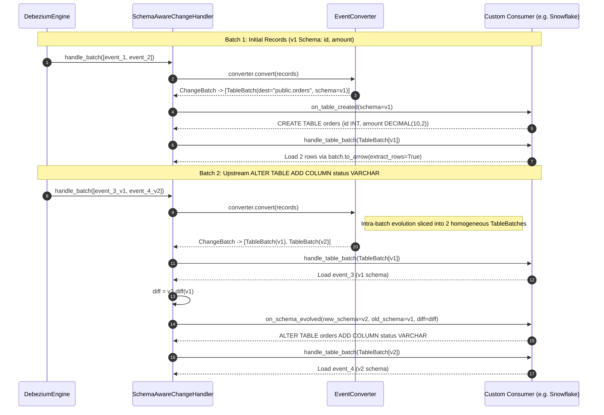

# Schema-Aware Consumer & Examples

`SchemaAwareChangeHandler` (`pydbzengine.schema.handler`) is the base class for schema-driven CDC consumers. It converts incoming `ChangeEvent` batches via `EventConverter`, tracks the active `TableSchema` per destination, and dispatches lifecycle hooks.

## Lifecycle Hooks & Dispatch Sequence

When `DebeziumEngine` passes a batch of `ChangeEvent` records to `SchemaAwareChangeHandler.handle_batch()`, the handler converts the batch into a `ChangeBatch`, slices data records into homogeneous `TableBatch` runs via `batch.table_batches()`, and invokes:

1. **`on_table_created(self, schema: TableSchema) -> None`**
   Called the first time a `TableSchema` is observed for a destination.
2. **`on_schema_evolved(self, new_schema: TableSchema, old_schema: TableSchema, diff: SchemaDiff) -> None`**
   Called whenever a destination's `TableSchema` differs from its previously tracked version, passing the computed `SchemaDiff`.
3. **`handle_table_batch(self, batch: TableBatch) -> None`**
   Called for each homogeneous `TableBatch` after `on_table_created` or `on_schema_evolved` has completed.



---

## PyArrow Consumer Example

This consumer logs table creation and schema evolution events and materializes each batch into an unpacked `pyarrow.Table`:

```python
from pydbzengine import DebeziumEngine
from pydbzengine.schema import (
    SchemaAwareChangeHandler,
    SchemaDiff,
    TableBatch,
    TableSchema,
)


class ArrowBatchHandler(SchemaAwareChangeHandler):
    def on_table_created(self, schema: TableSchema) -> None:
        self.log.info(
            "Table created: %s (primary_keys=%s, fields=%s)",
            schema.destination,
            schema.primary_keys,
            schema.row_schema.names,
        )

    def on_schema_evolved(
        self,
        new_schema: TableSchema,
        old_schema: TableSchema,
        diff: SchemaDiff,
    ) -> None:
        self.log.info(
            "Schema evolved for %s: compatible=%s, added=%s",
            new_schema.destination,
            diff.is_compatible,
            [f.name for f in diff.added_fields],
        )

    def handle_table_batch(self, batch: TableBatch) -> None:
        arrow_table = batch.to_arrow(extract_rows=True)
        self.log.info(
            "Consumed %d rows for %s (columns=%s)",
            arrow_table.num_rows,
            batch.destination,
            arrow_table.column_names,
        )


if __name__ == "__main__":
    props = {
        "name": "arrow-cdc-consumer",
        "connector.class": "io.debezium.connector.postgresql.PostgresConnector",
        "database.hostname": "localhost",
        "database.port": "5432",
        "database.user": "postgres",
        "database.password": "postgres",
        "database.dbname": "inventory",
        "topic.prefix": "cdc",
        "offset.storage": "org.apache.kafka.connect.storage.FileOffsetBackingStore",
        "offset.storage.file.filename": "/tmp/offsets.dat",
    }

    handler = ArrowBatchHandler()
    engine = DebeziumEngine(properties=props, handler=handler)
    engine.run()
```

---

## Custom Snowflake CDC Consumer Example

The `SnowflakeChangeHandler` below demonstrates how to build a custom database sink using `SchemaAwareChangeHandler`:

- **`arrow_type_to_snowflake_sql`**: Maps `schema.row_schema` field types to Snowflake DDL types.
- **`on_table_created`**: Executes `CREATE TABLE IF NOT EXISTS` with primary key constraints.
- **`on_schema_evolved`**: Verifies `diff.is_compatible` and executes `ALTER TABLE ... ADD COLUMN` for `diff.added_fields`.
- **`handle_table_batch`**: Appends keyless tables directly from `batch.to_arrow(extract_rows=True)`, or stages keyed CDC records with their operation code (`__CDC_OP`) and executes an atomic `MERGE INTO` statement applying inserts, updates, and deletes.

```python
from __future__ import annotations

from typing import Any

import pyarrow as pa

from pydbzengine import DebeziumEngine
from pydbzengine.schema import (
    ChangeOp,
    SchemaAwareChangeHandler,
    SchemaDiff,
    TableBatch,
    TableSchema,
)


def arrow_type_to_snowflake_sql(dtype: pa.DataType) -> str:
    if pa.types.is_boolean(dtype):
        return "BOOLEAN"
    if pa.types.is_integer(dtype):
        return "NUMBER(38, 0)"
    if pa.types.is_floating(dtype):
        return "FLOAT"
    if pa.types.is_decimal(dtype):
        return f"NUMBER({dtype.precision}, {dtype.scale})"
    if pa.types.is_string(dtype) or pa.types.is_large_string(dtype):
        return "VARCHAR"
    if pa.types.is_binary(dtype) or pa.types.is_large_binary(dtype):
        return "BINARY"
    if pa.types.is_date(dtype):
        return "DATE"
    if pa.types.is_time(dtype):
        return "TIME"
    if pa.types.is_timestamp(dtype):
        return "TIMESTAMP_TZ" if dtype.tz is not None else "TIMESTAMP_NTZ"
    if pa.types.is_struct(dtype) or pa.types.is_list(dtype) or pa.types.is_map(dtype):
        return "VARIANT"
    raise ValueError(f"Unsupported PyArrow type for Snowflake DDL: {dtype}")


class SnowflakeChangeHandler(SchemaAwareChangeHandler):
    def __init__(
        self,
        snowflake_conn: Any,
        target_schema: str,
    ) -> None:
        super().__init__()
        self.conn = snowflake_conn
        self.target_schema = target_schema

    def on_table_created(self, schema: TableSchema) -> None:
        table_fqn = f'"{self.target_schema}"."{schema.table_name.upper()}"'
        col_defs: list[str] = []

        for field in schema.row_schema:
            sf_type = arrow_type_to_snowflake_sql(field.type)
            null_clause = "" if field.nullable else " NOT NULL"
            col_defs.append(f'"{field.name.upper()}" {sf_type}{null_clause}')

        if schema.primary_keys:
            pk_cols = ", ".join(f'"{pk.upper()}"' for pk in schema.primary_keys)
            col_defs.append(f"PRIMARY KEY ({pk_cols})")

        ddl = f"CREATE TABLE IF NOT EXISTS {table_fqn} ({', '.join(col_defs)})"
        self.log.info("Executing DDL: %s", ddl)
        with self.conn.cursor() as cur:
            cur.execute(ddl)

    def on_schema_evolved(
        self,
        new_schema: TableSchema,
        old_schema: TableSchema,
        diff: SchemaDiff,
    ) -> None:
        if not diff.is_compatible:
            raise RuntimeError(
                f"Incompatible schema evolution for '{new_schema.destination}': "
                f"removed={[f.name for f in diff.removed_fields]}, "
                f"changed={[(o.name, o.type, n.type) for o, n in diff.changed_fields]}"
            )

        if not diff.added_fields:
            return

        table_fqn = f'"{self.target_schema}"."{new_schema.table_name.upper()}"'
        add_clauses = [
            f'"{field.name.upper()}" {arrow_type_to_snowflake_sql(field.type)}'
            for field in diff.added_fields
        ]
        alter_sql = f"ALTER TABLE {table_fqn} ADD COLUMN {', '.join(add_clauses)}"
        self.log.info("Executing DDL: %s", alter_sql)
        with self.conn.cursor() as cur:
            cur.execute(alter_sql)

    def handle_table_batch(self, batch: TableBatch) -> None:
        from snowflake.connector.pandas_tools import write_pandas

        schema = batch.schema
        target_table = schema.table_name.upper()
        table_fqn = f'"{self.target_schema}"."{target_table}"'

        if not schema.primary_keys:
            df = batch.to_arrow(extract_rows=True).to_pandas()
            df.columns = [col.upper() for col in df.columns]
            write_pandas(
                conn=self.conn,
                df=df,
                table_name=target_table,
                schema=self.target_schema,
                quote_identifiers=True,
            )
            return

        staged_rows: list[dict[str, Any]] = []
        for record in batch:
            if record.op is ChangeOp.TRUNCATE or record.op is ChangeOp.MESSAGE:
                continue
            row_data = record.data
            if row_data is None:
                continue
            op_code = "D" if record.op is ChangeOp.DELETE else "U"
            staged_rows.append({**row_data, "__CDC_OP": op_code})

        if not staged_rows:
            return

        stage_table = f"STAGE_{target_table}"
        stage_fqn = f'"{self.target_schema}"."{stage_table}"'
        stage_schema = schema.row_schema.append(pa.field("__CDC_OP", pa.string()))
        stage_df = pa.Table.from_pylist(staged_rows, schema=stage_schema).to_pandas()
        stage_df.columns = [col.upper() for col in stage_df.columns]

        with self.conn.cursor() as cur:
            cur.execute(
                f"CREATE TEMPORARY TABLE IF NOT EXISTS {stage_fqn} LIKE {table_fqn}"
            )
            cur.execute(
                f'ALTER TABLE {stage_fqn} ADD COLUMN IF NOT EXISTS "__CDC_OP" VARCHAR'
            )
            cur.execute(f"TRUNCATE TABLE {stage_fqn}")

        write_pandas(
            conn=self.conn,
            df=stage_df,
            table_name=stage_table,
            schema=self.target_schema,
            quote_identifiers=True,
        )

        join_cond = " AND ".join(
            f't."{pk.upper()}" = s."{pk.upper()}"' for pk in schema.primary_keys
        )
        col_names = [f.name.upper() for f in schema.row_schema]
        update_set = ", ".join(f't."{c}" = s."{c}"' for c in col_names)
        insert_cols = ", ".join(f'"{c}"' for c in col_names)
        insert_vals = ", ".join(f's."{c}"' for c in col_names)

        merge_sql = f"""
        MERGE INTO {table_fqn} AS t
        USING {stage_fqn} AS s
        ON {join_cond}
        WHEN MATCHED AND s."__CDC_OP" = 'D' THEN DELETE
        WHEN MATCHED AND s."__CDC_OP" = 'U' THEN UPDATE SET {update_set}
        WHEN NOT MATCHED AND s."__CDC_OP" = 'U' THEN INSERT ({insert_cols}) VALUES ({insert_vals})
        """
        with self.conn.cursor() as cur:
            cur.execute(merge_sql)


if __name__ == "__main__":
    import snowflake.connector

    sf_conn = snowflake.connector.connect(
        user="cdc_user",
        password="cdc_password",
        account="xy12345.us-east-1",
        warehouse="CDC_WH",
        database="ANALYTICS",
        schema="PUBLIC",
    )

    dbz_props = {
        "name": "snowflake-cdc-engine",
        "connector.class": "io.debezium.connector.postgresql.PostgresConnector",
        "database.hostname": "localhost",
        "database.port": "5432",
        "database.user": "postgres",
        "database.password": "postgres",
        "database.dbname": "inventory",
        "topic.prefix": "cdc",
        "table.include.list": "public.customers,public.orders",
        "offset.storage": "org.apache.kafka.connect.storage.FileOffsetBackingStore",
        "offset.storage.file.filename": "/tmp/snowflake_offsets.dat",
    }

    handler = SnowflakeChangeHandler(
        snowflake_conn=sf_conn,
        target_schema="PUBLIC",
    )
    engine = DebeziumEngine(properties=dbz_props, handler=handler, format="connect")
    engine.run()
```

---

## Tombstones, Heartbeats & Standalone Conversion

### Handling Tombstones and Heartbeats
`SchemaAwareChangeHandler.handle_change_batch` dispatches `EventKind.DATA` batches to `handle_table_batch`. To process delete tombstones (`EventKind.TOMBSTONE`) or heartbeats (`EventKind.HEARTBEAT`), override `handle_change_batch`:

```python
from pydbzengine.schema import (
    ChangeBatch,
    EventKind,
    SchemaAwareChangeHandler,
)


class TombstoneAwareHandler(SchemaAwareChangeHandler):
    def handle_change_batch(self, batch: ChangeBatch) -> None:
        super().handle_change_batch(batch)

        for tombstone in batch.of_kind(EventKind.TOMBSTONE):
            self.log.info(
                "Tombstone on %s: key=%s",
                tombstone.destination,
                tombstone.key,
            )

        for hb in batch.of_kind(EventKind.HEARTBEAT):
            self.log.debug("Heartbeat on %s: %s", hb.destination, hb.value)
```

### Standalone `EventConverter` Usage
`EventConverter` can also be used directly without subclassing `SchemaAwareChangeHandler`:

```python
from pydbzengine.schema import JsonEventConverter

converter = JsonEventConverter()
change_batch = converter.convert(raw_events)

for table_batch in change_batch.table_batches():
    arrow_table = table_batch.to_arrow(extract_rows=True)
```
