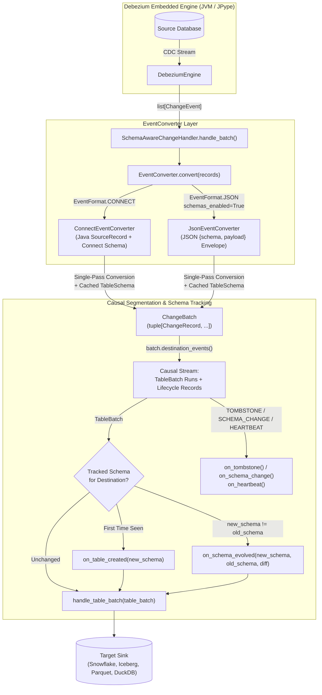
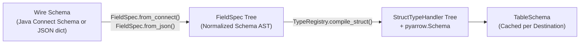

# Schema Subsystem Architecture (`pydbzengine.schema`)

The `pydbzengine.schema` package compiles schema-enabled Debezium `ChangeEvent` batches into Apache Arrow (`pyarrow`) schemas, tables, and typed Python domain entities.

Downstream consumers that extend `SchemaAwareChangeHandler` receive compiled `TableSchema` descriptors, structural `SchemaDiff` objects, homogeneous `TableBatch` runs, and ordered lifecycle events rather than raw JSON strings or Java Kafka Connect `SourceRecord` objects.

!!! note "Schema-Enabled Requirement"
    `pydbzengine.schema` strictly requires schema-enabled events: either `EventFormat.CONNECT` (`format="connect"`) or `EventFormat.JSON` (`format="json"`) with `schemas_enabled=True` (`converter.schemas.enable=true`, the default). Passing schemaless JSON (`schemas_enabled=False`) fails fast with a `ValueError`. If you consume schemaless JSON payloads, subclass [`BasePythonChangeHandler`](../handlers/custom.md) directly.

## Raw vs. Schema-Aware Consumption

| Capability | `BasePythonChangeHandler` | `SchemaAwareChangeHandler` (`pydbzengine.schema`) |
| :--- | :--- | :--- |
| **Input Contract** | Raw `ChangeEvent` strings or Java `SourceRecord` proxies | Typed `TableBatch` and `ChangeRecord` entities |
| **Supported Modes** | Connect, schema-enabled JSON, and schemaless JSON | Schema-enabled Connect and JSON (`schemas_enabled=True`) |
| **Wire Format Resolution** | Handled manually by the consumer | Resolved once from `DebeziumConfig` via `configure()` |
| **Type Conversion** | Raw JSON primitives, Base64 strings, or Java objects | Single-pass conversion to Python types and `pyarrow.DataType` |
| **Tabular Output** | Manual dictionary construction | Direct `batch.to_arrow(target_schema=...)` (`pyarrow.Table`) |
| **Schema Tracking** | Manual tracking per destination | Automatic `on_table_created` and `on_schema_evolved` hooks with `SchemaDiff` |
| **Intra-Batch DDL & Lifecycle** | Mixed schema versions and event kinds in one list | Causally ordered `TableBatch` runs plus `on_tombstone`, `on_schema_change`, and `on_heartbeat` hooks |

---

## Public Surface & Module Layout

Consumer code should import from the top-level `pydbzengine.schema` package, which exports 11 public symbols:

| Category | Public Exports (`from pydbzengine.schema import ...`) |
| :--- | :--- |
| **Domain Models** | `TableSchema`, `SchemaDiff`, `ChangeRecord`, `TableBatch`, `ChangeBatch`, `EventKind` |
| **Converters & Formats** | `EventConverter`, `ConnectEventConverter`, `JsonEventConverter`, `EventFormat` |
| **Consumer Base Class** | `SchemaAwareChangeHandler` |

Compiler internals are separated into focused submodules under `pydbzengine.schema`:

- `pydbzengine.schema.spec`: `FieldSpec` — normalized immutable schema AST parsed from Java Connect or JSON schemas.
- `pydbzengine.schema.handlers`: `DataTypeHandler`, `SchemaField`, and scalar, decimal, binary, and nested (`Struct`, `Array`, `Map`) handlers.
- `pydbzengine.schema.temporal`: `DateTypeHandler`, `TimeTypeHandler`, `TimestampTypeHandler`, and `TimeUnit`.
- `pydbzengine.schema.registry`: `TypeRegistry` — compiles `FieldSpec` trees into bound `DataTypeHandler` and `SchemaField` instances.

---

## End-to-End Conversion Pipeline

---

## Deterministic Converter Resolution

At initialization, `DebeziumEngine` normalizes connector `properties` and `format` into a `DebeziumConfig` instance and configures the attached handler via `handler.configure(config=self.config)`. `SchemaAwareChangeHandler` delegates to `EventConverter.from_config(config=config)` to instantiate the matching converter deterministically:

| Converter Class | Resolution Condition | Execution Behavior |
| :--- | :--- | :--- |
| **`ConnectEventConverter`** | `format="connect"` (`EventFormat.CONNECT`) | Consumes in-memory Java Kafka Connect `SourceRecord` objects. Compiles `valueSchema()` and `keySchema()` once per destination (caching strong references to the Java schemas) and converts values in a single pass via `convert_connect()`. |
| **`JsonEventConverter`** | `format="json"` and `schemas_enabled=True` (*default*) | Consumes JSON records containing explicit `{"schema": ..., "payload": ...}` envelopes. Compiles the embedded schemas once per destination and converts payloads in a single pass via `convert_json()`. |

If `format="json"` is configured with `schemas_enabled=False` (or `converter.schemas.enable=false`), `EventConverter.from_config()` raises `ValueError` immediately rather than falling back to schema inference.

---

## Default Debezium Envelopes vs. Flat Rows (`ExtractNewRecordState`)

`pydbzengine.schema` is strictly pass-through with respect to payload shape: `TableSchema.arrow_schema` compiles the exact top-level struct emitted by Debezium, and `ChangeRecord.value` holds the converted dictionary matching that schema.

- **Default Debezium Envelope (no SMT)**:
  Debezium emits records with top-level `before`, `after`, `source`, `op`, `ts_ms`, and `transaction` fields. `before` and `after` are compiled as nested Arrow `struct` columns. Both `SchemaDiff` (`is_additive`, `is_compatible`) and `TableBatch.to_arrow(target_schema=...)` understand nested struct evolution when source table columns are added or widened inside `before`/`after`.
- **Flat Table Rows (`ExtractNewRecordState` SMT)**:
  When you want flat table columns directly in `schema.arrow_schema` and `batch.to_arrow()` (for example, when loading into a relational warehouse or lakehouse table), configure Debezium's `io.debezium.transforms.ExtractNewRecordState` transform with `add.fields` (such as `op`) and `delete.tombstone.handling.mode` (`rewrite` or `drop`). Each `ChangeRecord.value` is then a flat row dictionary with the table columns and any configured metadata fields at top level.

---

## Schema Compilation & Caching

When `ConnectEventConverter` or `JsonEventConverter` encounters a destination for the first time—or observes an updated wire schema—it compiles the schema in three steps:

1. **Normalization (`FieldSpec` in `spec.py`)**: Parses the JSON schema dictionary or Java Connect `Schema` into an immutable `FieldSpec` tree capturing `name`, `type_name`, `optional`, `logical_name`, `doc`, `parameters`, and nested child specifications (`fields`, `items`, `keys`, `values`).
2. **Handler & Arrow Compilation (`TypeRegistry` in `registry.py`)**: Matches each `FieldSpec` against semantic logical types first, then parameterized decimals, primitives, and generic nested containers (`struct`, `array`, `map`), producing `SchemaField` objects with bound `DataTypeHandler` implementations and `pyarrow.Field` descriptors (preserving `doc` and `debezium.logical_type` in Arrow field metadata).
3. **Destination Caching (`TableSchema` in `models.py`)**: Builds an immutable `TableSchema` (`destination`, `arrow_schema`, `key_fields`, `key_schema`) paired internally in the converter cache with the compiled `StructTypeHandler` and key handler. Subsequent events with an equal wire schema reuse the cached entry without recompiling.

## Next Steps

- **[Domain Models & Types](models.md)**: Reference for `TableSchema`, `SchemaDiff`, `ChangeRecord`, `TableBatch`, `ChangeBatch`, and the compiled `DataTypeHandler` classes.
- **[Schema-Aware Consumer & Examples](consumer.md)**: Lifecycle hooks on `SchemaAwareChangeHandler` and complete implementations including a custom Snowflake CDC consumer.
