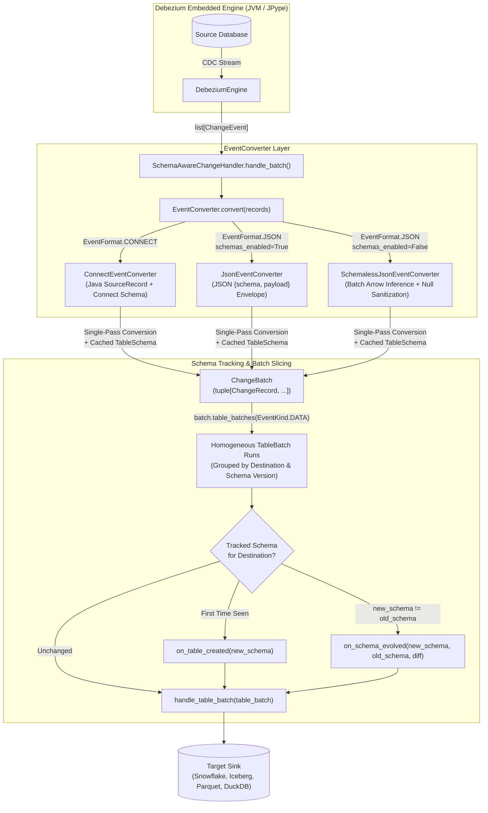
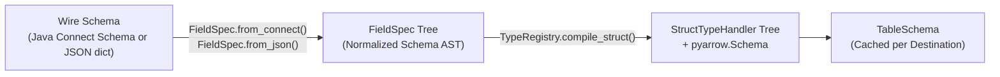

# Schema Subsystem Architecture (`pydbzengine.schema`)

The `pydbzengine.schema` package converts raw Debezium `ChangeEvent` batches into Apache Arrow (`pyarrow`) schemas, tables, and typed Python domain entities.

Downstream consumers that extend `SchemaAwareChangeHandler` receive compiled `TableSchema` descriptors, structural `SchemaDiff` objects, and homogeneous `TableBatch` runs rather than raw JSON strings or Java Kafka Connect `SourceRecord` objects.

## Raw vs. Schema-Aware Consumption

| Capability | `BasePythonChangeHandler` | `SchemaAwareChangeHandler` (`pydbzengine.schema`) |
| :--- | :--- | :--- |
| **Input Contract** | Raw `ChangeEvent` strings or Java `SourceRecord` proxies | Typed `TableBatch` and `ChangeRecord` entities |
| **Wire Format Resolution** | Handled manually by the consumer | Resolved once at instantiation by `SchemaAwareChangeHandler` |
| **Type Conversion** | Raw JSON primitives, Base64 strings, or Java objects | Single-pass conversion to Python types and `pyarrow.DataType` |
| **Tabular Output** | Manual dictionary construction | Direct `batch.to_arrow(extract_rows=True)` (`pyarrow.Table`) |
| **Schema Tracking** | Manual tracking per destination | Automatic `on_table_created` and `on_schema_evolved` hooks with `SchemaDiff` |
| **Intra-Batch DDL** | Mixed schema versions within a single batch | Automatically sliced into homogeneous `TableBatch` runs |

---

## End-to-End Conversion Pipeline

---

## Deterministic Converter Resolution

At initialization, `DebeziumEngine` wraps connector `properties` and `format` into a `DebeziumConfig` instance and configures the attached handler via `handler.configure(config=self.config)`. `SchemaAwareChangeHandler` delegates to `EventConverter.from_config(config=config)` to instantiate one of three concrete converter classes without runtime format probing:

| Converter Class | Resolution Condition | Execution Behavior |
| :--- | :--- | :--- |
| **`ConnectEventConverter`** | `format="connect"` (`EventFormat.CONNECT`) | Consumes in-memory Java Kafka Connect `SourceRecord` objects. Compiles `valueSchema()` and `keySchema()` into a cached `TableSchema` (retaining strong references to the Java schema objects) and converts payloads in a single pass via `convert_connect()`. |
| **`JsonEventConverter`** | `format="json"` and `schemas.enable=true` (*default*) | Consumes JSON records containing explicit `{"schema": ..., "payload": ...}` blocks. Compiles the embedded schema blocks once per destination into a cached `TableSchema` and converts payloads in a single pass via `convert_json()`. |
| **`SchemalessJsonEventConverter`** | `format="json"` and `schemas.enable=false` | Consumes raw JSON payload objects without embedded schemas. Groups payloads by destination across the batch, infers a `pyarrow.Schema`, reconciles `before`/`after` envelope symmetry, reuses known field types from previous batches for all-null columns, and tags remaining all-null fields with `debezium.inferred_null = b"true"` metadata. |

!!! note "Schemaless Null Promotion (`debezium.inferred_null`)"
    In schemaless JSON mode, when a column is `null` across all rows in the first observed batch, `SchemalessJsonEventConverter` assigns `pa.string()` with field metadata `{b"debezium.inferred_null": b"true"}`. When a subsequent batch contains a non-null value for that column (such as `int64` or `timestamp`), `SchemaDiff.is_compatible` treats the transition from an `inferred_null` field to a concrete type as compatible.

---

## Schema Compilation & Caching

When `ConnectEventConverter` or `JsonEventConverter` encounters a destination for the first time—or observes an updated wire schema—it compiles the schema in three steps:

1. **Normalization (`FieldSpec`)**: Parses the JSON schema dictionary or Java Connect `Schema` into an immutable `FieldSpec` tree capturing `name`, `type_name`, `optional`, `logical_name`, `doc`, `parameters`, and child specifications (`fields`, `items`, `keys`, `values`).
2. **Handler & Arrow Compilation (`TypeRegistry`)**: Matches each `FieldSpec` against logical type names first, then primitive and complex types, producing a `SchemaField` with a bound `DataTypeHandler` and `pyarrow.Field` (preserving field documentation and logical type names in Arrow field metadata).
3. **Destination Caching (`TableSchema`)**: Wraps the compiled `StructTypeHandler`, `arrow_schema`, `key_schema`, and validated `primary_keys` into an immutable `TableSchema` cached per destination. Subsequent events with an identical wire schema reuse the cached `TableSchema` directly.

## Next Steps

- **[Domain Models & Types](models.md)**: Reference for `TableSchema`, `SchemaDiff`, `ChangeRecord`, `TableBatch`, `ChangeBatch`, and the 18 `DataTypeHandler` classes.
- **[Schema-Aware Consumer & Examples](consumer.md)**: Lifecycle hooks on `SchemaAwareChangeHandler` and complete implementations including a custom Snowflake CDC consumer.
