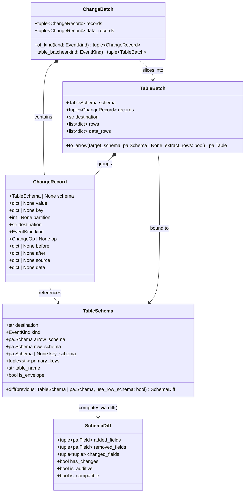

# Domain Models & Data Types

This page documents the domain entities in `pydbzengine.schema.models` and the data type handlers in `pydbzengine.schema.types`.

## Domain Model Relationships

---

## Domain Entities (`pydbzengine.schema.models`)

### `TableSchema`
Immutable compiled schema descriptor for a destination:

| Attribute / Method | Type | Description |
| :--- | :--- | :--- |
| `destination` | `str` | Full destination identifier (e.g., `"cdc_prod.inventory.orders"`). |
| `table_name` | `str` | Table name extracted from the destination suffix (e.g., `"orders"`). |
| `kind` | `EventKind` | Destination category (`DATA`, `HEARTBEAT`, or `SCHEMA_CHANGE`). |
| `arrow_schema` | `pa.Schema` | Full event PyArrow schema (includes `before`, `after`, `source`, `op`, `ts_ms` for envelopes). |
| `row_schema` | `pa.Schema` | Unpacked table row PyArrow schema (extracts the inner struct of `after`/`before` for envelopes, or returns `arrow_schema` for flattened events). |
| `is_envelope` | `bool` | `True` when `arrow_schema` is a Debezium `before`/`after`/`op` envelope. |
| `key_schema` | `pa.Schema \| None` | PyArrow schema of the event key, if present. |
| `primary_keys` | `tuple[str, ...]` | Validated scalar primary key column names present in the table row fields. |
| `diff(previous, *, use_row_schema=True)` | `SchemaDiff` | Computes the structural difference from `previous` (`TableSchema` or `pa.Schema`) to `self`. |

### `SchemaDiff`
Structural comparison result between an older and newer `TableSchema`:

| Attribute / Property | Type | Description |
| :--- | :--- | :--- |
| `added_fields` | `tuple[pa.Field, ...]` | Fields added in the new schema. |
| `removed_fields` | `tuple[pa.Field, ...]` | Fields present in the previous schema that were removed. |
| `changed_fields` | `tuple[tuple[pa.Field, pa.Field], ...]` | `(old_field, new_field)` pairs whose `pa.DataType` changed. |
| `has_changes` | `bool` | `True` if any fields were added, removed, or changed. |
| `is_additive` | `bool` | `True` if fields were added with zero removals or type changes. |
| `is_compatible` | `bool` | `True` if no fields were removed and all type changes are promotions from `debezium.inferred_null` fields. |

### `ChangeRecord`, `EventKind` & `ChangeOp`
`ChangeRecord` represents a single converted CDC event:

- **`kind: EventKind`**:
  - `EventKind.DATA` (`"data"`)
  - `EventKind.HEARTBEAT` (`"heartbeat"`)
  - `EventKind.SCHEMA_CHANGE` (`"schema_change"`)
  - `EventKind.TOMBSTONE` (`"tombstone"`, when `value is None`)
- **`op: ChangeOp | None`**:
  - `ChangeOp.INSERT` (`"c"`), `ChangeOp.UPDATE` (`"u"`), `ChangeOp.DELETE` (`"d"`), `ChangeOp.READ` (`"r"`), `ChangeOp.TRUNCATE` (`"t"`), `ChangeOp.MESSAGE` (`"m"`), or `None`.
- **State Accessors**:
  - `before: dict[str, Any] | None`: Row state prior to `UPDATE` or `DELETE` in envelope mode.
  - `after: dict[str, Any] | None`: Row state after `INSERT`, `READ`, or `UPDATE` in envelope mode.
  - `source: dict[str, Any] | None`: Debezium `source` metadata block.
  - `data: dict[str, Any] | None`: Active unpacked row dictionary (`after` if present, `before` on delete in envelope mode, or `value` directly for flattened events).
  - `key: dict[str, Any] | None`: Converted key dictionary.
  - `value: dict[str, Any] | None`: Converted full payload dictionary (`None` for tombstones).

### `TableBatch` & `ChangeBatch`
- **`ChangeBatch`**: Holds `records: tuple[ChangeRecord, ...]` in arrival order.
  - `batch.of_kind(kind: EventKind) -> tuple[ChangeRecord, ...]`: Filters records by `EventKind`.
  - `batch.data_records -> tuple[ChangeRecord, ...]`: Shorthand for `batch.of_kind(EventKind.DATA)`.
  - `batch.table_batches(kind: EventKind = EventKind.DATA) -> tuple[TableBatch, ...]`: Groups records of `kind` by destination and slices them into consecutive `TableBatch` runs whenever a destination's `TableSchema` changes.
- **`TableBatch`**: Groups consecutive `ChangeRecord` items sharing a single `TableSchema`.
  - `batch.rows -> list[dict[str, Any]]`: Full event dictionaries matching `schema.arrow_schema`.
  - `batch.data_rows -> list[dict[str, Any]]`: Unpacked active row dictionaries matching `schema.row_schema`.
  - `batch.to_arrow(target_schema=None, *, extract_rows=False) -> pa.Table`: Materializes a `pyarrow.Table` from `rows` (when `extract_rows=False`) or `data_rows` (when `extract_rows=True`).

---

## Data Type Handlers (`pydbzengine.schema.types`)

`TypeRegistry` compiles `FieldSpec` nodes into dedicated `DataTypeHandler` classes. Logical type names (`logical_name`) are matched before generic `struct` or `array` types so Debezium logical structures bind to their specific handlers:

| Handler Class | Debezium / Connect Types & Logical Names | Target PyArrow Type (`pa.DataType`) | Python Runtime Value |
| :--- | :--- | :--- | :--- |
| **`IntTypeHandler`** | `int8`, `int16`, `int32`, `int64` | `pa.int8()`, `pa.int16()`, `pa.int32()`, `pa.int64()` | `int` |
| **`FloatTypeHandler`** | `float32`, `float64` | `pa.float32()`, `pa.float64()` | `float` |
| **`BooleanTypeHandler`** | `boolean` | `pa.bool_()` | `bool` |
| **`StringTypeHandler`** | `string`, `io.debezium.data.Uuid`, `Json`, `Xml`, `Enum`, `EnumSet`, `Ltree`, `IsoInterval` | `pa.string()` | `str` |
| **`TemporalIntervalHandler`** | `io.debezium.time.Year` (`int32`), `MicroDuration` (`int64`), `NanoDuration` (`int64`) | `pa.int32()` / `pa.int64()` | `int` |
| **`BinaryTypeHandler`** | `bytes`, `io.debezium.data.Bits` | `pa.binary()` | `bytes` |
| **`DecimalTypeHandler`** | `org.apache.kafka.connect.data.Decimal` | `pa.decimal128(precision, scale)` | `decimal.Decimal` |
| **`VariableScaleDecimalHandler`** | `io.debezium.data.VariableScaleDecimal`, `SpecialValueDecimal` | `pa.decimal128(precision, scale)` | `decimal.Decimal` |
| **`DateTypeHandler`** | `org.apache.kafka.connect.data.Date`, `io.debezium.time.Date` | `pa.date32()` | `datetime.date` or `int` (epoch days) |
| **`TimeTypeHandler`** | `Time`, `MicroTime`, `NanoTime`, `ZonedTime` | `pa.time32("ms")`, `pa.time64("us")`, `pa.time64("ns")` | `datetime.time` or `int` |
| **`TimestampTypeHandler`** | `Timestamp`, `MicroTimestamp`, `NanoTimestamp`, `ZonedTimestamp` | `pa.timestamp(unit, tz=None \| "UTC")` | `datetime.datetime` or `int` |
| **`GeometryTypeHandler`** | `io.debezium.data.geometry.Geometry`, `Geography` | `pa.struct([("wkb", pa.binary()), ("srid", pa.int32())])` | `dict[str, Any]` |
| **`PointTypeHandler`** | `io.debezium.data.geometry.Point` | `pa.struct([("x", float64), ("y", float64), ("wkb", binary), ("srid", int32)])` | `dict[str, Any]` |
| **`DenseVectorHandler`** | `io.debezium.data.vector.FloatVector`, `DoubleVector` | `pa.list_(pa.float32())` / `pa.list_(pa.float64())` | `list[float]` |
| **`SparseVectorHandler`** | `io.debezium.data.vector.SparseDoubleVector` | `pa.struct([("dimensions", int16), ("vector", map<int16, float64>)])` | `dict[str, Any]` |
| **`StructTypeHandler`** | `struct` (nested records & Debezium envelopes) | `pa.struct([...])` | `dict[str, Any]` |
| **`ArrayTypeHandler`** | `array` | `pa.list_(item_type)` | `list[Any]` |
| **`MapTypeHandler`** | `map`, `io.debezium.data.Hstore` | `pa.map_(key_type, item_type)` | `dict[Any, Any]` |
